Venho da ciência de dados e da operação, onde todo dia chega uma base nova, a planilha de controle tem
uma aba por equipe e alguém confere tudo linha por linha. Quase tudo o que está aqui nasceu desse tipo
de problema. Hoje estou em **transição para o desenvolvimento fullstack**, com o pé mais firme no
backend: regras de negócio que precisam estar certas, dados que não podem se perder e sistemas que
registram o que fizeram.

---

## Projetos

Cada projeto mostra a situação real dele. O que ainda não existe aparece como pendente.

### Conciliação diária de pendências · [`pending-reconciliation`](https://github.com/PabloHoDev/pending-reconciliation)

`em construção` · TypeScript · Node.js · Next.js · Drizzle · PostgreSQL · Vitest · Playwright

**O problema:** todo dia um ERP exporta um extrato de repasses. Num dia comum são cerca de 40 mil, e
nos picos são bem mais. Esse extrato precisa virar a lista de
pendências de cada parceiro. É preciso atualizar as que já estão em acompanhamento, arquivar as concluídas
e separar as devolvidas, sem perder nenhum protocolo. Antes, isso era feito com planilhas e macros. 
**O que construí:** um motor de conciliação idempotente e transacional, com regras versionadas. O
Postgres é organizado em camadas (`raw → staging → crp → analytics`), com histórico SCD2 e auditoria de
antes e depois. Uma aplicação web serve para operar o processo. Tudo roda com dados sintéticos de uma
empresa fictícia.

### Crowslot · [`crowslot-saas`](https://github.com/PabloHoDev/crowslot-saas)

`em desenvolvimento` · Next.js · TypeScript · Prisma · PostgreSQL · Auth.js · Zod · Stripe

**O problema:** um SaaS de agenda para salões e barbearias, em que várias empresas dividem o mesmo
banco e nenhuma pode ver os dados de outra. 
**O que construí:** o isolamento por organização é resolvido no servidor e reforçado pelo próprio
Postgres. Se algum código esquecer um filtro, o banco recusa a escrita. Também fiz papéis
`OWNER/ADMIN/MEMBER`, limites por plano, convites com expiração e log de auditoria. A agenda sem
horários sobrepostos é garantida por uma restrição no banco. A cobrança com Stripe ainda está em
andamento.

### excel-sync-tool · [repositório](https://github.com/PabloHoDev/excel-sync-tool) · [demo](https://excel-sync-tool.vercel.app)

`funcionando` · Python · openpyxl · pytest · Next.js

**O problema:** sincronizar a exportação diária de um sistema com uma planilha de controle de várias
abas, sem quebrar a formatação, a proteção das abas nem o que foi preenchido à mão. 
**O que construí:** um índice `chave → (aba, linha)` montado uma única vez, para que cada busca seja
O(1). A ferramenta escreve só nas células que mudaram e gera um log auditável. No cenário da demo,
são 160 processos em 4 abas: a conferência manual leva cerca de 55 minutos e a ferramenta faz o mesmo
em menos de 1 segundo.

### Enterprise Workflow Engine · [`enterprise-workflow-engine`](https://github.com/PabloHoDev/enterprise-workflow-engine)

`funcional` · Java 25 · Spring Boot · PostgreSQL · Docker · API REST + console web

Um motor que transforma processos de aprovação em fluxos versionados e auditáveis. Ele recusa
definições com estados inalcançáveis ou becos sem saída e só permite as transições previstas, com
autorização por papel e regras como `amount > 10000`. O domínio é Java puro, sem Spring, JPA nem HTTP,
e é testado sem infraestrutura. As decisões estão registradas em 10 ADRs.

### Dungeon Crawler · [`dotnet-dungeon-crawler`](https://github.com/PabloHoDev/dotnet-dungeon-crawler)

`em andamento` · C# · .NET 10 · xUnit

É um jogo que uso como laboratório de arquitetura. As regras ficam num núcleo em C# puro, e a direção
das dependências entre as camadas é verificada por testes. Hoje ele roda no terminal. A camada em Unity
ainda não existe.

Outros projetos

- [`corporateflow-automation`](https://github.com/PabloHoDev/corporateflow-automation): automação de
  fluxos baseados em planilhas, em Python, com backup, validação, logs e pytest.
- [`elt-pipeline`](https://github.com/PabloHoDev/elt-pipeline): estudo de pipeline de dados com pandas.
- [`file-organizer`](https://github.com/PabloHoDev/file-organizer): organizador de arquivos em Python.

---

## Com o que trabalho

Só entra aqui o que está em algum projeto acima.

| Área               | Tecnologias                                                       | Onde ver                                  |
| ------------------ | ----------------------------------------------------------------- | ----------------------------------------- |
| Linguagens         | TypeScript, Java, Python, C#                                      | todos os projetos acima                   |
| Backend            | Node.js, Spring Boot, Next.js (App Router, Server Actions), .NET  | conciliação, Crowslot, workflow engine    |
| Dados              | PostgreSQL, Prisma, Drizzle, pandas, openpyxl                     | conciliação, Crowslot, excel-sync-tool    |
| Qualidade          | Vitest, Playwright, pytest, xUnit, GitHub Actions, CodeQL         | conciliação, Crowslot, excel-sync-tool, workflow engine |
| Infra              | Docker Compose, Vercel, Neon                                      | workflow engine, demo do excel-sync-tool  |

## Como trabalho

Se você abrir o histórico dos meus repositórios mais antigos, vai encontrar commits como
`Update arquivo.ts` feitos direto na `main`. Eu não escondo isso, porque é o ponto de partida. Desde
então, mudei a forma de trabalhar, e os projetos recentes já mostram a diferença: Pull Requests, CI e
decisões documentadas. Ainda erro, mas cada projeto sai mais bem feito que o anterior. Hoje sigo isto:

- **Branch, Pull Request e CI verde antes de entrar na `main`,** com commits no padrão Conventional
  Commits.
- **Decisões grandes ficam escritas** em ADRs, com o contexto, a escolha e o que ela custa.
- **Regra de negócio tem teste.** Quando corrijo um bug, ele ganha um teste que o reproduz.
- **Demos usam dados fictícios.** Os problemas vêm do mundo real, mas nenhum dado real sai dele.

---

[Sobre mim](https://pablohodev.github.io/PabloHoDev/) · [LinkedIn](https://www.linkedin.com/in/pablo-henrique-oliveira-7a4610227/) · [GitHub](https://github.com/PabloHoDev)
